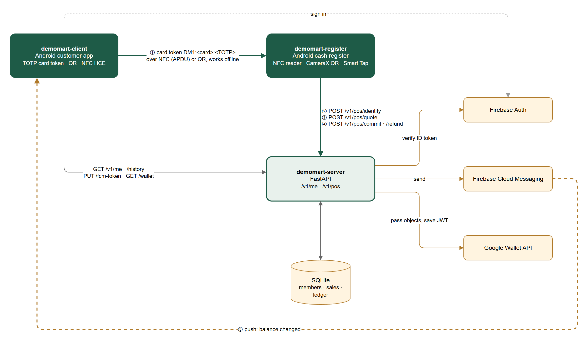
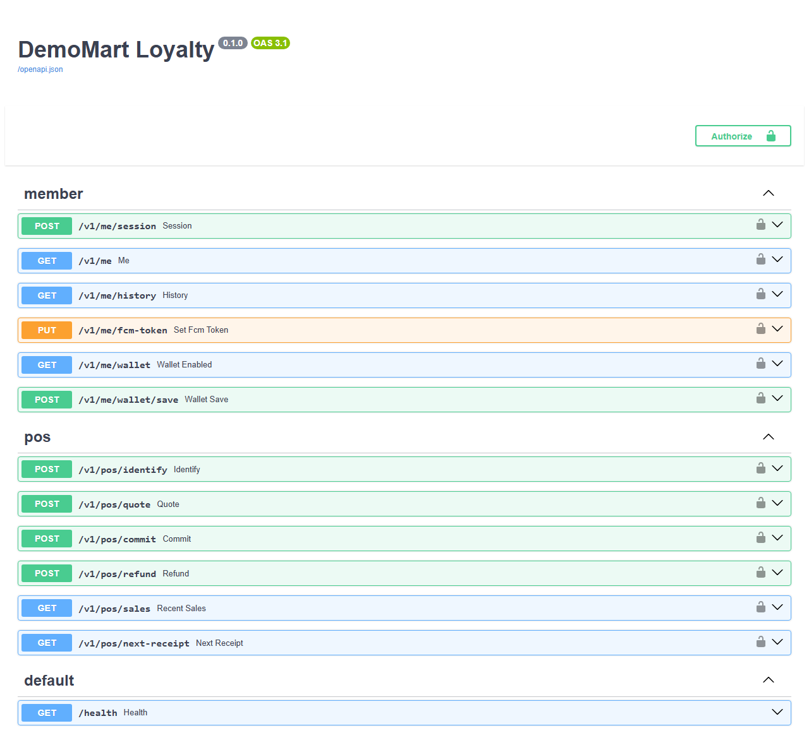

<p align="center"></p>

<h1 align="center">DemoMart Loyalty server</h1>

<p align="center">Part of <a href="https://github.com/DoroninMA/demomart"><b>DemoMart</b></a>, a demo loyalty card system</p>

FastAPI + SQLite backend for the DemoMart loyalty demo. Python 3.12.

## Architecture

<p align="center"></p>

The register sends the card token from the customer's phone, prices and commits the sale; the server pushes the new balance to the customer app over FCM. Source: `docs/architecture.drawio`.

## Run locally

Docker:

```powershell
Copy-Item .env.example .env
docker compose up --build -d --wait
docker compose exec server python -m loyalty.seed
curl.exe http://127.0.0.1:8000/health
```

Or a venv:

```powershell
py -3.12 -m venv .venv
.\.venv\Scripts\Activate.ps1
pip install -r requirements-dev.txt
$env:AUTH_MODE = "fake"
python -m loyalty.seed
uvicorn loyalty.asgi:app --host 127.0.0.1 --port 8000
```

The venv run keeps the database in `./loyalty.db` (override with `DATABASE_PATH`). Docker keeps it in `./data`.

Tests: `python -m pytest`.

## Demo data

`python -m loyalty.seed` creates:

| Account | Role | Balance |
|---|---|---:|
| `anna@demo.test` | customer | 1355 |
| `ben@demo.test` | customer | 240 |
| `chloe@demo.test` | customer | 0 |
| `bob@demo.test` | cashier | |

`SEED_GOOGLE_EMAIL` adds one more customer with 860 points; the first Google sign-in with that email gets this card. In Firebase mode `SEED_PASSWORD` sets the password of the built-in accounts. Running the seed again keeps the sale history.

## Auth

`AUTH_MODE=fake` accepts `fake:<uid>:<email>:<name>` as the bearer token, e.g.

- `fake:seed-anna:anna@demo.test:Anna K.`
- `fake:seed-bob:bob@demo.test:Bob`

Use it only on a local server. The Android emulator reaches it at `http://10.0.2.2:8000`.

`AUTH_MODE=firebase` verifies Firebase ID tokens. Enable Email/Password and Google sign-in in the Firebase project and point `GOOGLE_APPLICATION_CREDENTIALS` at the Admin SDK key. The same key is used for FCM.

## Google Wallet

Optional; off while `WALLET_ISSUER_ID` is empty.

1. Create an issuer in the Pay & Wallet Console (demo mode is fine).
2. Enable the Google Wallet API and create a service account with a JSON key.
3. In the Wallet console, add the service account under Users as Developer.
4. Set `WALLET_ISSUER_ID`, `WALLET_SERVICE_ACCOUNT` and `WALLET_LOGO_URL` (public HTTPS URL of `/static/wallet-logo.png`).
5. Run `python -m loyalty.wallet_setup` once.

In demo mode passes show [TEST ONLY] and only console users and test accounts can save them. If the rotating QR does not work on a device, set `WALLET_BARCODE_MODE=static` and add the card again.

## Deploy

The demo runs on a small Ubuntu VPS: venv + systemd + nginx with a Let's Encrypt certificate.

```bash
useradd --system --user-group --shell /usr/sbin/nologin loyalty
install -d -o loyalty -g loyalty -m 0750 /opt/loyalty/data
cd /opt/loyalty/server
python3 -m venv .venv && .venv/bin/pip install -r requirements.txt
install -m 0600 .env.example /opt/loyalty/.env   # then edit it
```

In `/opt/loyalty/.env` set `AUTH_MODE=firebase`, `DATABASE_PATH=/opt/loyalty/data/loyalty.db` and the Firebase/Wallet values. Keep the keys in `/opt/loyalty/secrets` (`root:loyalty`, `0640`).

Seed as the service user, then start the unit:

```bash
systemd-run --wait --pipe --collect --uid=loyalty --gid=loyalty \
  --working-directory=/opt/loyalty/server --property=EnvironmentFile=/opt/loyalty/.env \
  /opt/loyalty/server/.venv/bin/python -m loyalty.seed
install -m 0644 deploy/loyalty.service /etc/systemd/system/
systemctl daemon-reload && systemctl enable --now loyalty
```

The API listens on `127.0.0.1:8000`; nginx proxies HTTPS to it (`certbot --nginx` for the certificate). `deploy/Caddyfile` is an alternative if you prefer Caddy.

## API

OpenAPI docs at `/docs`. Amounts are integer euro cents. Protected routes take `Authorization: Bearer <id_token>`; errors come back as `{"error": "<code>", "message": "..."}`.

| Method | Path | |
|---|---|---|
| GET | `/health` | |
| POST | `/v1/me/session` | card number and TOTP secret |
| GET | `/v1/me` | profile and balance |
| GET | `/v1/me/history?limit=50` | sales and refunds |
| PUT | `/v1/me/fcm-token` | push token |
| GET | `/v1/me/wallet` | is Wallet enabled |
| POST | `/v1/me/wallet/save` | Add to Google Wallet link |
| POST | `/v1/pos/identify` | card token → `customer_ref` (valid 10 min) |
| POST | `/v1/pos/quote` | price a sale with redemption |
| POST | `/v1/pos/commit` | record a sale, idempotent per register + receipt |
| POST | `/v1/pos/refund` | refund a whole sale |
| GET | `/v1/pos/sales?register_id=R1` | recent sales |
| GET | `/v1/pos/next-receipt?register_id=R1` | next receipt number |

POS routes need a cashier. `customer_ref: null` means a sale without a card.

<p align="center"></p>

## License

MIT, see `LICENSE`.
